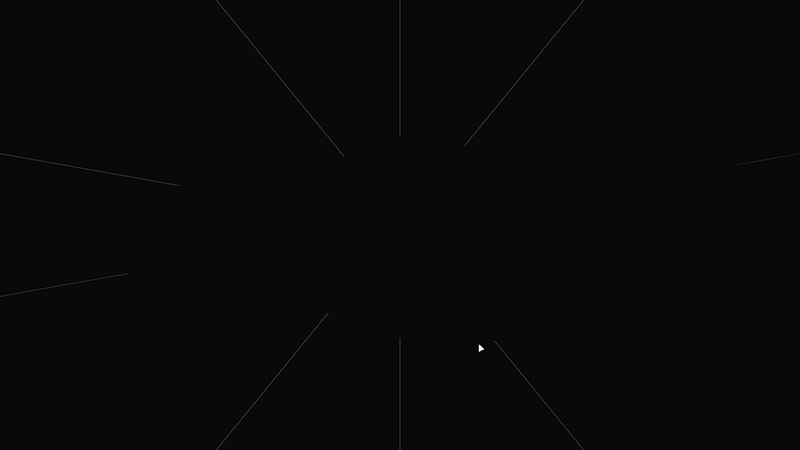

# Flavio Raise — Portfolio

My personal portfolio: a minimal, dark, monochrome single-page site with a beam-formed **FR** opening animation, neon hover effects and a fully responsive layout.

🔗 **Live:** [flavioraise.com](https://flavioraise.com) · **GitHub:** [@flavioraise](https://github.com/flavioraise)

## Highlights

- **Opening animation** — light beams sweep in from the screen edges and resolve into the FR wordmark, then lift to reveal the site.
- **Neon aesthetic** — the same white glow carries through to the favicon and project-card hover states.
- **Responsive** — tuned across mobile (including tall phones like the Z Fold 5 / iPhone Pro), tablet and desktop.
- **Motion-aware** — respects `prefers-reduced-motion`.

## Tech Stack

- [Next.js 16](https://nextjs.org) (App Router, Turbopack)
- [React 19](https://react.dev)
- [Tailwind CSS 4](https://tailwindcss.com)
- [Motion](https://motion.dev) for animation
- TypeScript
